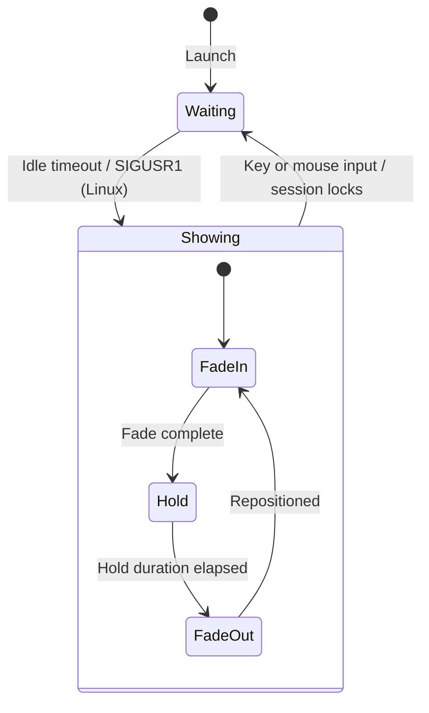

<div align="center">

# olsvr

**OLED screensaver for Wayland and macOS: fade-animated clock on pure black**

[](https://github.com/laveez/olsvr/actions/workflows/ci.yml)
[](https://github.com/laveez/olsvr/releases/latest)
[](LICENSE)
[](https://www.rust-lang.org)
[](#requirements)
[](#requirements)

</div>

---

olsvr prevents OLED burn-in by displaying a fading clock that periodically repositions itself on a pure black background. It activates after a configurable idle timeout, renders with GPU acceleration via wgpu, and dismisses on any keyboard or mouse input. It runs natively on Linux (Wayland, via Vulkan) and macOS (via Metal) behind a shared, platform-agnostic core.


### Contents

- [Features](#features) · [Quick Start](#quick-start) · [Setup Wizard](#setup-wizard) · [Autostart](#autostart) · [Configuration](#configuration) · [Keep-Awake and Locking](#keep-awake-and-locking)
- [How It Works](#how-it-works) · [Requirements](#requirements) · [Troubleshooting](#troubleshooting) · [Known Limitations](#known-limitations) · [Contributing](#contributing)

---

## Features

- **Cross-platform:** native Linux (Wayland) and macOS backends behind a shared core
- **Idle detection:** `ext-idle-notify-v1` or D-Bus (GNOME) on Wayland, CoreGraphics event idle on macOS, after a configurable timeout
- **Fade animation:** the clock fades in, holds, fades out, then jumps to a new position
- **Quadrant-aware repositioning:** each jump lands in a different screen quadrant; a clock too wide or tall for a quadrant uses the full width or height instead
- **Multi-display:** cover the main display or every connected display (macOS); on Wayland, one fullscreen window on the output the compositor picks
- **Weather overlay:** colored Nerd Font weather icons with temperature and wind speed via [FMI Open Data](https://en.ilmatieteenlaitos.fi/open-data)
- **GPU-accelerated:** wgpu + glyphon text rendering (Vulkan on Wayland, Metal on macOS)
- **Configurable:** font, size, color, timing, date and time format, and activation policy in `~/.olsvr.toml`; a value olsvr cannot use is logged and replaced with its default
- **Interactive setup wizard:** `olsvr setup` walks through configuration with a live preview
- **Autostart:** a systemd user service bound to the graphical session (Linux) or a launchd login agent with no Dock icon (macOS)
- **Keep-awake:** holds off display sleep while the saver shows (Wayland idle inhibitor, macOS `IOPMAssertion`), or for the whole session on GNOME and macOS
- **Lock-aware:** does not show over a locked session, hides when the session locks, and releases its keep-awake hold while locked (GNOME and macOS)
- **Manual trigger:** `olsvr run --activate` makes a running instance show now (Linux)
- **Video-aware:** stays away while another app keeps the screen on, such as a video, a call or a keep-awake tool
- **Input dismissal:** any key press or mouse movement dismisses the saver immediately
- **Fail-safe:** a panic on the main thread, or on macOS a render loop stalled for 5 s, ends the process rather than leave a black window on screen; the autostart service or agent then starts olsvr again

---

## Quick Start

Install the latest release, then run the setup wizard. Building needs Rust 1.89 or newer and, on Linux, a few system packages: see [Requirements](#requirements).

```bash
cargo install --locked --git https://github.com/laveez/olsvr --tag v0.3.0
olsvr setup
```

Run, preview and stop it:

```bash
olsvr run
olsvr run --now
olsvr run --activate
olsvr stop
olsvr --version
```

- `olsvr run` runs in the foreground (plain `olsvr` does the same once a config exists)
- `olsvr run --now` previews now; the first input ends it
- `olsvr run --activate` makes the running instance show now (Linux only)
- `olsvr stop` stops the running instance (macOS: also the login agent)
- `olsvr --version` prints the version of the installed binary

> **`--now` beside a running instance:** on Linux it makes that instance show instead of previewing the binary you ran; on macOS it exits with status 4 until you `olsvr stop` the agent.
>
> **`olsvr` not found after `cargo install`?** Cargo installs into `~/.cargo/bin`. rustup puts that directory on your `PATH`; with Rust from your distribution or Homebrew, add it yourself.
>
> **macOS:** `olsvr stop` is how to stop the login agent: if the process quits any other way, launchd restarts it.

### Install from a clone

```bash
git clone https://github.com/laveez/olsvr.git
cd olsvr
cargo install --locked --path .
```

`--locked` builds the dependency versions pinned in `Cargo.lock`, which are the ones CI tests.

### Upgrading

Install the new version the same way (add `--force` if cargo refuses because the `olsvr` binary already exists), then run `olsvr setup` again and answer Yes at the autostart step. The prompts start from your current settings, so Enter keeps them, and setup rewrites `~/.olsvr.toml` without your comments. Setup rewrites the systemd unit and restarts the service (Linux), or copies the new binary into the app bundle and reloads the login agent (macOS). The running saver keeps the old build until it restarts (on macOS, until setup has refreshed the bundle), even though `olsvr --version` already prints the new version; [Troubleshooting](#troubleshooting) shows how to tell which build runs. If you start olsvr from your compositor's config instead of the service, answer No at the autostart step and restart olsvr yourself.

---

## Setup Wizard

Running `olsvr setup` (or just `olsvr` on first run) starts an interactive wizard that guides you through:

1. **Timing:** idle timeout, hold duration, fade speed
2. **Display:** font size, font family, time and date format, brightness, edge padding
3. **Weather:** on or off, location, update interval, font size, icon font
4. **Preview:** an optional live preview of your settings; press Enter in the terminal to end it
5. **Autostart:** optionally install a systemd user service (Linux) or a launchd login agent (macOS) that starts on login

Before the autostart step you can change timing, display or weather again, or start over. The wizard writes `~/.olsvr.toml` and can be re-run at any time; its prompts start from the current settings, so Enter keeps them. It rewrites the whole file, so comments in it are lost. If the existing file does not parse, the wizard copies it to `~/.olsvr.toml.bak` and starts from the defaults.

---

## Autostart

### Linux (systemd)

At the autostart step, the wizard writes `~/.config/systemd/user/olsvr.service`, enables and restarts it, and checks two seconds later that it stayed up. The unit:

- runs `olsvr run` from the path of the binary that ran setup, so run setup from the installed `olsvr` (the wizard asks first when that binary is a cargo `target/` build)
- starts with `graphical-session.target` and stops with it
- restarts olsvr after a failure, at most 5 times a minute, but not after exit status 3 (no Wayland compositor) or 4 (already running)
- unsets `DISPLAY` and `XAUTHORITY` (see [NVIDIA](#nvidia-linux))

[`olsvr.service`](olsvr.service) in this repository is the same unit with `%h/.cargo/bin/olsvr` as the binary. To install it by hand instead, run this from a clone of the repository:

```bash
mkdir -p ~/.config/systemd/user
cp olsvr.service ~/.config/systemd/user/
systemctl --user daemon-reload
systemctl --user enable --now olsvr.service
```

**GNOME and KDE Plasma** start `graphical-session.target`, so the unit starts at login.

**sway and Hyprland** usually do not, unless you launch them through [uwsm](https://github.com/Vladimir-csp/uwsm) or a similar session manager. Otherwise start olsvr from the compositor's config, the line setup prints (use `~/.cargo/bin/olsvr` if the compositor's `PATH` lacks it):

```text
# sway: ~/.config/sway/config
exec olsvr run

# Hyprland: ~/.config/hypr/hyprland.conf
exec-once = olsvr run
```

Use one starter, not both: a second copy exits with status 4. If you start `graphical-session.target` yourself, import `WAYLAND_DISPLAY` into the systemd user manager first:

```bash
systemctl --user import-environment WAYLAND_DISPLAY
```

Otherwise the unit exits with status 3 and stays down until you restart it or log in again.

### macOS (launchd)

At the autostart step, the wizard copies the binary into `~/Applications/olsvr.app`, an ad-hoc signed app bundle that runs without a Dock icon, writes `~/Library/LaunchAgents/io.github.laveez.olsvr.plist`, and loads the agent. launchd starts it at login and restarts it whenever it exits; `olsvr stop` unloads it until the next login. The agent logs to `~/Library/Logs/olsvr.log`.

Run `olsvr setup` from the `olsvr` that `cargo install` put on your `PATH`: setup copies the binary it runs from into the bundle. After the agent starts or restarts, the saver waits one full `timeout` before it can show.

---

## Configuration

Settings live in `~/.olsvr.toml`. All fields are optional; defaults are used for anything omitted. The setup wizard (`olsvr setup`) is the easiest way to set the timing, display and weather values. It does not ask about `[activation]`, so edit the file for that table.

olsvr reads and checks the file once, when it starts. It logs each value it cannot use as an error and uses that field's default instead, and if the file does not parse, it logs why and runs with the default settings. After editing the file by hand, restart olsvr.

Linux:

```bash
systemctl --user restart olsvr
```

macOS:

```bash
olsvr stop
launchctl bootstrap gui/$(id -u) ~/Library/LaunchAgents/io.github.laveez.olsvr.plist
```

### General

| Field | Description | Default |
|---|---|---|
| `timeout` | Idle time before the saver shows, in whole minutes (at least 1) | `5` |

### Clock

The clock settings work as top-level keys, or in a `[[layers]]` table with `type = "clock"`. Once the file has `[[layers]]`, the clock layer's keys apply and the top-level ones are ignored; the wizard writes both when the weather overlay is on. A `[[layers]]` table without a `type` is a clock.

| Field | Description | Default |
|---|---|---|
| `font_size` | Font size in pixels (1 to 2000) | `200` |
| `font_family` | `sans-serif`, `serif`, `monospace`, `cursive`, `fantasy`, or the name of an installed font | `sans-serif` |
| `time_format` | `24h` or `12h` | `24h` |
| `date_format` | [chrono format string](https://docs.rs/chrono/latest/chrono/format/strftime/) | `%a %d %b` |
| `color` | Text color `[r, g, b]`, 0 to 255 each; the wizard's brightness scales it | `[255, 255, 255]` |
| `hold` | Time the clock stays fully visible between fades, in whole seconds | `10` |
| `fade_duration` | Fade-in and fade-out time, in whole milliseconds | `1500` |
| `edge_padding` | Minimum distance from the screen edges, in pixels (0 to 10000) | `50` |

The generic families map to fixed fonts: `sans-serif` to Open Sans, `serif` to DejaVu Serif, `monospace` to Noto Sans Mono, `cursive` to Comic Sans MS, and `fantasy` to Impact (Papyrus on macOS). When that font is not installed, the text falls back to another font, so naming an installed font gives a predictable result. The wizard offers the generic families and keeps a font name you already set.

### Weather

The weather overlay shows a colored icon, the temperature and the wind speed below the clock, from the [FMI Open Data](https://en.ilmatieteenlaitos.fi/open-data) forecast for `location`. olsvr fetches it from the first activation on, every `update_interval` seconds. If FMI rejects the place, olsvr logs FMI's reason; if fetches keep failing, the line disappears once its data is three intervals old. Icons are Nerd Font weather glyphs: install a [Nerd Font](https://www.nerdfonts.com/) with weather icons (e.g. MesloLGS NF).

The overlay is a `[[layers]]` table with `type = "weather"`:

| Field | Description | Default |
|---|---|---|
| `location` | Place name, as plain text rather than URL-encoded (spaces are fine) | `helsinki` |
| `update_interval` | Seconds between fetches, at least `300`; a lower value is raised to 300 | `600` |
| `font_size` | Weather text size in pixels (1 to 2000) | `24` |
| `icon_font` | Nerd Font family for the weather icons | `MesloLGS NF` |

### Activation

The `[activation]` table sets which displays the saver covers and what it keeps awake. The wizard keeps what you set here; only its Start over choice resets the table to the defaults.

| Field | Description | Default |
|---|---|---|
| `displays` | `primary` (the main display only) or `all` (every connected display). `all` is macOS only: Wayland shows one window, on the output the compositor picks. | `primary` |
| `keep_awake` | `while-active`, `always` or `off`; see [Keep-Awake and Locking](#keep-awake-and-locking) | `while-active` |

### Example

```toml
timeout = 5

[[layers]]
type = "clock"
font_size = 200
font_family = "sans-serif"
time_format = "24h"
date_format = "%a %d %b"
color = [200, 200, 200]
hold = 10
fade_duration = 1500
edge_padding = 50

[[layers]]
type = "weather"
location = "helsinki"
update_interval = 600
font_size = 24
icon_font = "MesloLGS NF"

[activation]
displays = "all"             # macOS; Wayland always shows one window
keep_awake = "while-active"  # or "always" (macOS, GNOME) or "off"
```

### CLI flags

Flags of `olsvr run`; they override the config file for that run.

| Flag | Description |
|---|---|
| `--timeout <TIMEOUT>` | Idle timeout in minutes before activation (at least 1) |
| `--font-size <FONT_SIZE>` | Clock font size in pixels |
| `--hold <HOLD>` | Hold duration between fades, in seconds |
| `--fade-duration <FADE_DURATION>` | Fade duration in milliseconds |
| `--edge-padding <EDGE_PADDING>` | Edge padding in pixels |
| `--now` | Show the saver now, as a preview that ends at the first input. If an instance is already running, Linux makes it show instead, and macOS exits with status 4 |
| `--activate` | Send SIGUSR1 to a running instance to activate it (Linux only) |
| `--debug` | Show a debug overlay with frame count, timing and source (Linux; the overlay stays empty on macOS) |

`--font-size`, `--hold`, `--fade-duration` and `--edge-padding` set the top-level clock keys, so they have no effect on a config with `[[layers]]`.

`olsvr run` exits with status 4 when another instance is already running, and on Linux with status 3 when it cannot connect to a Wayland compositor. The systemd unit does not restart olsvr after either.

---

## Keep-Awake and Locking

`keep_awake` in `[activation]` decides what olsvr holds off while you are away:

| `keep_awake` | GNOME | sway, Hyprland and other Wayland compositors | macOS |
|---|---|---|---|
| `while-active` (default) | No screen blank or auto-lock while the saver shows | Idle tools such as swayidle and hypridle neither blank nor lock while the saver shows | No display sleep, and no lock that follows display sleep, while the saver shows |
| `always` | The same for the whole unlocked session | Not supported: olsvr logs an error and acts as `while-active` | The same for the whole unlocked session |
| `off` | Nothing held: GNOME's own screen blank and auto-lock run over the saver | Nothing held: your idle tools run as configured | Nothing held: display sleep, and the lock that follows it, run as configured |

On Wayland, unless `keep_awake` is `off`, the saver's window carries an idle inhibitor while it shows, and GNOME's mutter passes it on to the session manager; under `always`, olsvr also holds a GNOME session inhibitor from startup. On macOS, olsvr holds an `IOPMAssertion` that prevents display sleep, which also keeps the Mac from idle-sleeping, on battery too.

**While the session is locked** (GNOME and macOS; on macOS also while your session is switched out), olsvr does not show, hides a saver that is up when the lock starts, and lets go of its hold, so the locked screen blanks on the desktop's own schedule. Under `always` it takes the hold again when you unlock.

> **Security note:** with `while-active` (the default) or `always`, these locks wait while the saver shows, so the session stays unlocked until you return: GNOME's automatic screen lock, a lock that swayidle or hypridle would start, and on macOS a lock that follows display sleep. Under `always` they also wait while the saver is hidden, for as long as the session is unlocked (GNOME and macOS). Lock the screen yourself when you leave (Super+L on GNOME, Ctrl+Cmd+Q on macOS), or set `keep_awake = "off"` to let the desktop's idle lock run over the saver.

**Other apps keep the saver away.** olsvr does not activate while another app holds idle off: a playing video, a call, or a keep-awake tool such as GNOME's Caffeine extension or `caffeinate -d` on macOS. On Wayland it respects other apps' idle inhibitors. On macOS it respects other apps' display-sleep assertions, including the ones Chrome and Firefox hold during video, and the log names the app that holds one.

**GNOME's Blank Screen Delay.** olsvr's default `timeout` of 5 minutes equals GNOME's default Blank Screen Delay (Settings > Privacy & Security > Screen Lock, or the `idle-delay` key of `org.gnome.desktop.session`: 300 seconds). With equal values both fire at once, and GNOME may blank and lock the screen before the saver shows. Set `timeout` below GNOME's delay if you want the clock.

---

## How It Works



The animation cycle runs continuously while the screensaver shows:

1. **Fade in:** the clock appears at a random position, and its opacity rises from 0 to full
2. **Hold:** the clock stays fully visible for `hold` seconds
3. **Fade out:** its opacity drops back to 0
4. **Reposition:** the clock jumps to a different screen quadrant; when it is too wide or tall for half the screen, it uses the full width or height on that axis instead

The weather line follows the clock, centered below it.

The saver is a fullscreen black surface: on Linux, one Wayland window on the output the compositor picks; on macOS, a borderless `NSWindow` at screen-saver level on each target display. Any key press or mouse movement dismisses it, and olsvr goes back to waiting for idle; a `--now` preview exits instead.

On Wayland, olsvr learns about idle through `ext-idle-notify-v1` where the compositor offers it (sway, Hyprland), and otherwise polls GNOME's Mutter IdleMonitor over D-Bus about once a second. On GNOME it also watches the lock screen over D-Bus. On macOS it polls the system idle time from CoreGraphics once a second.

---

## Requirements

- **Rust 1.89 or newer**, installed with [rustup](https://rustup.rs); distribution packages can be older
- **Nerd Font** (optional, for weather icons): install from [nerdfonts.com](https://www.nerdfonts.com/)

**Linux (Wayland):**

- GNOME, or a Wayland compositor with `ext-idle-notify-v1` such as sway or Hyprland
- A GPU with a Vulkan driver (wgpu's Vulkan backend); the Vulkan loader and libwayland are loaded at runtime
- To build: a C compiler, pkg-config, and the libdbus and libxkbcommon development files

Debian and Ubuntu:

```bash
sudo apt install build-essential pkg-config libdbus-1-dev libxkbcommon-dev
```

Fedora:

```bash
sudo dnf install gcc pkgconf-pkg-config dbus-devel libxkbcommon-devel
```

Arch:

```bash
sudo pacman -S --needed base-devel pkgconf dbus libxkbcommon
```

**macOS:**

- macOS 11 (Big Sur) or newer, tested on Apple silicon; renders with Metal via wgpu, on the low-power GPU of a Mac that has two (`WGPU_POWER_PREF=high` picks the other)
- Xcode Command Line Tools for the C compiler and linker (`xcode-select --install`)

---

## Troubleshooting

**Logs.** olsvr logs at info level by default.

| olsvr runs as | Log |
|---|---|
| systemd service (Linux) | `journalctl --user -u olsvr.service` |
| launchd agent (macOS) | `~/Library/Logs/olsvr.log` |
| `olsvr run` in a terminal | the terminal |

For more detail, stop the service or agent and run olsvr in a terminal with a higher `RUST_LOG` level. A `RUST_LOG` set in your shell does not reach the service or agent, which set their own.

```bash
olsvr stop
RUST_LOG=olsvr=debug olsvr run
```

**Which build runs.** `olsvr --version` prints the version of the `olsvr` on your `PATH`. The running saver logs `olsvr <version> (<path>)` when it starts. After an upgrade the two differ until the saver restarts: `olsvr setup` restarts it, and on Linux so does the next login. On macOS the agent runs the copy in the app bundle, which only `olsvr setup` replaces; `~/Applications/olsvr.app/Contents/MacOS/olsvr --version` prints its version.

**The saver does not show.**

- `olsvr is already running (PID <pid>)`: another instance holds the PID file (`$XDG_RUNTIME_DIR/olsvr.pid` on Linux, `~/Library/Application Support/olsvr/olsvr.pid` on macOS); stop it with `olsvr stop`.
- Another app holds idle off (see [Keep-Awake and Locking](#keep-awake-and-locking)). On macOS the log says `Not activating while "<app>" (pid <pid>) holds a display-sleep assertion`; on GNOME the skip is logged at debug level.
- The session is locked: olsvr does not show over a lock screen (GNOME, macOS).
- Linux: after a failed GPU init, olsvr does not activate for 10 minutes (`GPU init failed, not activating for the next 10 min`); see [NVIDIA](#nvidia-linux) for one cause. During the pause `olsvr run --activate` and `olsvr run --now` beside the running instance report success, but the saver does not show; the log says `GPU init failed recently, not activating for another ...`
- A GPU error or a lost GPU device hides the saver at once and logs `GPU error: ...` or `GPU device lost (...)`. The saver comes back after another full `timeout` if you are still away.
- macOS: after the agent starts or restarts, the first show waits one full `timeout`.

### NVIDIA (Linux)

NVIDIA drivers before 615.71.09 leak two file descriptors for each Vulkan instance a process destroys while `DISPLAY` is set (NVIDIA bug 6446591). olsvr avoids the leak: it keeps one Vulkan instance for its whole run and drops `DISPLAY` and `XAUTHORITY` at startup. Driver 615.71.09 fixes it on NVIDIA's side.

After an NVIDIA driver update, reboot. Until then the old kernel module rejects the updated userspace driver wherever it is loaded anew, as in a restarted olsvr (`journalctl -k` shows `NVRM: API mismatch`), and the saver renders on another GPU or not at all. olsvr logs the GPU of every show (`GPU adapter: ...`), and logs `GPU driver changed since login, reboot to restore GPU rendering` once when a show lands on the CPU or on another GPU than its first show.

---

## Known Limitations

- **macOS: display changes while the saver shows.** olsvr places its windows when the saver comes up. A display that connects, reconnects (an HDMI re-detect, a dock or KVM switch) or changes resolution while the saver shows gets no saver window until the next activation, so it shows the desktop until you return.
- **Wayland: one window.** `displays = "all"` works on macOS only; on Wayland the saver covers the one output the compositor picks.
- **Wayland: lock screens other than GNOME's.** olsvr watches only GNOME's lock screen, so on other desktops it does not know when the session is locked.
- **Wayland: touch.** olsvr dismisses the saver on keyboard and mouse input; it does not read touch input.
- **CLI overrides and `[[layers]]`:** see [CLI flags](#cli-flags).

---

## Contributing

Contributions are welcome! Open an issue or submit a PR.

```bash
git clone https://github.com/laveez/olsvr.git
cd olsvr
git config core.hooksPath .githooks
cargo build
```

The `core.hooksPath` line enables the pre-push fmt, clippy and test checks.

Stop an installed olsvr with `olsvr stop` before you run a build from the tree. Beside a running instance, `run` exits with status 4, and `run --now` shows the installed saver on Linux or exits with status 4 on macOS.

```bash
cargo run -- run --now
cargo run -- run --now --debug
RUST_LOG=olsvr=debug cargo run -- run
```

The first line previews the saver, the second adds the debug overlay (Linux only), and the third runs in the foreground with debug logs. Afterwards, bring the installed one back.

Linux:

```bash
systemctl --user start olsvr
```

macOS:

```bash
launchctl bootstrap gui/$(id -u) ~/Library/LaunchAgents/io.github.laveez.olsvr.plist
```

CI runs `cargo fmt --check`; clippy, the tests and a release build on Linux and macOS; `cargo check` on Rust 1.89, the minimum supported version; and a RustSec advisory check with cargo-deny.

## License

[MIT](LICENSE)
